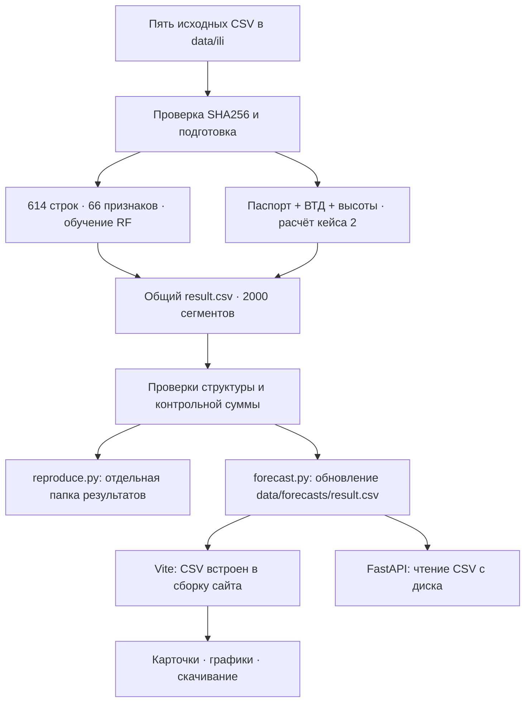

# Недра · PipeTwin

**Прогноз остаточной толщины стенки трубопровода по историческим данным и интерфейс для анализа результата по 10-метровым сегментам.** Проект объединяет два расчётных кейса, воспроизводимую подготовку данных, графики обследований и выгрузку общего `result.csv`.

Отдельный демонстрационный контур показывает гидравлику синтетической сети, виртуальные датчики и диагностику учебных утечек. Он не является моделью предоставленных трубопроводов и не подключён к онлайн-телеметрии.

## Результат двух кейсов

| | Кейс 1 — есть история ВТД | Кейс 2 — нет собственного ВТД |
| --- | --- | --- |
| Простой участок | `1250022871` | `1250009583` |
| Дата результата | 01.12.2023 | 01.07.2022 |
| Метод | Random Forest: относительная скорость потери толщины | Распределение опорной средней потери по высотному профилю, без обучения ML |
| Основа | ВТД от 06.07.2022, паспорт, высоты, режимы до целевой даты | Паспорт, высотный профиль, первые обследования других участков до целевой даты |
| Длина / номинальная стенка | 5 248,4 м / 8 мм | 14 745,1 м / 4,5 мм |
| Строки результата | 525, сегменты `0…524` | 1475, сегменты `0…1474` |
| Диапазон сохранённого прогноза | 3,394037–6,706299 мм | 3,0420–4,4270 мм |

Основной артефакт — [data/forecasts/result.csv](data/forecasts/result.csv): **2000 строк данных**, единый источник прогнозных значений для сайта и API. Для остальных участков интерфейс показывает историю, но не выдаёт прогноз из этого файла.

В текущем рабочем пути **CatBoost не используется**. Рецепт подготовки и обучения RF восстановлен по исходным CSV и ранее подготовленным таблицам; это восстановленная реализация, а не найденный оригинальный код обучения. При запуске она заново готовит признаки и обучает модель, не читая старую модель или готовую обучающую таблицу.

> Первый кейс использует фактически наблюдавшиеся режимы между базовым обследованием и целевой датой. Поэтому результат следует понимать как оценку толщины при известной истории эксплуатации, а не как прогноз, доступный в начале периода без знания последующих режимов. Дата аварии и вероятность отказа здесь не оцениваются.

## Архитектура и движение данных



Точки входа: [forecast.py](forecast.py) → [reproduction.publish](backend/reproduction/publish.py) → [reproduction.pipeline](backend/reproduction/pipeline.py). Отдельный [reproduce.py](reproduce.py) вызывает тот же расчёт без публикации результата на сайте. Для второго кейса используется именно `run_case2` из [wall_forecast/forecast.py](backend/wall_forecast/forecast.py).

В `wall_forecast` также сохранены альтернативный расчёт первого кейса, сопоставление дефектов и моделирование их роста. Они **не вызываются** основным пайплайном первого кейса. Старый [backend_bundle](backend_bundle/) содержит модель и подготовленные признаки предыдущей реализации; `forecast.py`, `reproduce.py` и API их не используют. При этом тест графика читает `backend_bundle/data/predict_features.csv` как эталон привязки базового обследования. [legacy-result.csv](tests/fixtures/forecast/legacy-result.csv) нужен только для сравнения версий.

## Исходные данные

Все пять файлов находятся в [data/ili](data/ili/). Их контрольные суммы и порядок признаков закреплены в [spec.json](backend/reproduction/spec.json). Изменение любого исходника останавливает штатный пересчёт: рецепт рассчитан на конкретный комплект выгрузок.

| Файл | Строк | Назначение в текущем расчёте |
| --- | ---: | --- |
| `pot_south.csv` | 16 | Идентификаторы участков, длины, диаметры, номинальная стенка, даты ввода, материал, покрытие и грунт |
| `altitudes_south.csv` | 20 218 | Пространственные признаки RF и высотный профиль второго кейса |
| `vtd_south_train.csv` | 48 291 | Базовая и целевая толщина RF; опорные обследования второго кейса |
| `tech_mode_for_embedings_with_length_with_temperatures_ids16.csv` | 39 052 | Суточные агрегаты режимов и временные признаки RF |
| `repcorr_south.csv` | 495 | Проверка происхождения данных и отдельный аудит коррозионного мониторинга; **не входит в 66 признаков RF** |

### Ключи, единицы и сетка

Паспортный `ID простого участка` сопоставляется с `id` в высотах и ВТД, `simple_section_id` в режимах и `Simple Section ID` в коррозионном мониторинге. Ключ результата — пара `(id, segment_id)`, ключ обучающей строки дополнительно включает дату `end`.

Паспортная длина переводится из километров в метры умножением на 1000. Расстояния `Distance` и `total_distance` используются в метрах; толщина и диаметр — в миллиметрах; уклон — м/м; интервалы времени для RF — годы по 365,25 дня. Режимные поля используются в численном представлении исходной выгрузки: отдельной унификации их единиц код подготовки не выполняет. `observed_liquid_sum` — сумма доступных суточных средних `q`, а не восстановленный интеграл за пропущенные дни.

Правила сетки различаются:

- **Кейс 1:** `ceil(length_m / 10)`, сегмент определяется как `floor(x / 10)`, принимаются точки `0 ≤ x < length_m`. Последний сегмент целевого участка — `[5240; 5248,4)` м, длина 8,4 м.
- **Кейс 2:** `floor(length_m / 10) + 1`, координаты ВТД прижимаются к диапазону `[0; length_m]`. Последний сегмент целевого участка — от 14 740 до 14 745,1 м, длина 5,1 м. При длине, кратной 10 м, эта реализация создаёт дополнительный концевой сегмент; правило не тождественно `ceil`.

### Координаты обследований и пропуски

Выгрузки ВТД имеют разные привязки: `Distance` — локальное расстояние, `Distance_raw` — исходная координата обследования. В RF применяется историческая линейная поправка **только к базовым обследованиям**:

```text
x = Distance + 0.06 + 7.26 × (Distance + offset) / 5248.4
```

Смещения цепочки: −44,9 м для `1250009490`, 0 для `1250022871`, 5248,4 м для `1250011604`. На целевом участке добавка меняется от 0,06 до 7,32 м; та же прямая продолжается на соседние участки. Это фиксированный рецепт, а не автоматическая регистрация каждого нового обследования.

Внутри сегмента RF берётся минимум непустого `Residual Wall Thickness`. Базовая толщина интерполируется в обе стороны; если заполнить её не удалось, используется паспортный номинал. Отдельный флаг `base_missing` сохраняет отсутствие исходного измерения. **Целевая толщина не сдвигается и не интерполируется:** сегменты без фактического значения исключаются из обучения. Строки не отбираются по одному только признаку внутреннего дефекта; явного фильтра `is_beyond_pot` здесь нет, границу задаёт координата.

Второй кейс использует другой загрузчик: оставляет записи, где заполнены и остаточная толщина, и глубина дефекта; линейную поправку RF не применяет. Для каждого сегмента вычисляет минимум остаточной толщины и медиану `Wall Thickness`. Пропуски последней интерполируются, затем заполняются медианой стенки опорного обследования. Сегмент без дефектов получает эту стенку, то есть нулевую относительную потерю; остаточный минимум между дефектами не интерполируется.

Поле `Defect Depth in %` неоднородно: выгрузка 2018 года содержит доли, более поздние — проценты. Загрузчик второго кейса умножает глубину на 100, если максимум по дате не превышает 1,5. RF использует непосредственно остаточную толщину и не включает глубину дефекта в признаки.

### Даты и дополнительные данные

В исходниках есть ВТД от 28.12.2014 для участков `1250013653`, `1250013655`, `1250013657`, `1250022875`, `1250022876`, хотя паспортная дата ввода — 16.03.2016. Текущий расчёт второго кейса **сохраняет эти обследования в опорной выборке**. В подготовке RF общего фильтра «после ввода» также нет, но эти пять участков не входят в его фиксированный список обучения. Предупреждение интерфейса об исключении ранних ВТД относится к ранее подготовленному снимку данных и не доказывает их исключение из нынешнего второго кейса.

УЗТ показано как точечное измерение в сохранённом [real-data.json](apps/web/src/features/pipelines/real-data.json). Отдельный старый конвейер [pipetwin_corrosion](backend/pipetwin_corrosion/pipeline.py) читает `uzt_south.csv`, а его [экспортёр интерфейса](backend/pipetwin_corrosion/export_ui.py) переносит подготовленные УЗТ в снимок. В комплекте `data/ili` этого файла нет; основной пересчёт его не требует. `tech_mode_temperature_filled.csv` также не входит в комплект и не читается текущим пайплайном или этим экспортёром. Наличие температуры и УЗТ на экране не означает использования заполненной температурной выгрузки или УЗТ в RF.

## Кейс 1: Random Forest

Подготовка реализована в [preparation.py](backend/reproduction/preparation.py), обучение и обратное преобразование — в [pipeline.py](backend/reproduction/pipeline.py).

### Обучающие периоды

| Базовое → целевое обследование | Участки и число обучающих сегментов | Всего |
| --- | --- | ---: |
| 23.09.2018 → 06.07.2022 | `1250009490`: 5; `1250011604`: 48; `1250022871`: 508 | 561 |
| 06.07.2022 → 01.12.2023 | `1250009490`: 5; `1250011604`: 48 | 53 |

Итого **614 строк × 75 столбцов** подготовленной таблицы, из них **66 входных признаков**. Метки целевого участка `1250022871` на 01.12.2023 в обучение не входят; в предоставленном ВТД такого обследования нет. Это не заменяет независимой проверки качества на неизвестных модели объектах и периодах.

### Признаки и временные окна

- Геометрия и паспорт: диаметр, номинал, возраст на целевую дату, материал, покрытие, грунт. Категории очищаются по краям, пропуски заменяются на `- Нет данных -`, затем кодируются целыми числами в отсортированном порядке **по всем паспортам**.
- Высоты: среднее, минимум, максимум внутри сегмента, линейный уклон через `polyfit`. Высоты интерполируются в обе стороны, отсутствующий уклон равен нулю. Отклонения от локального среднего и диапазоны высот считаются в центрированных окнах 5, 11 и 31 сегмент.
- Базовая стенка: значение, флаг пропуска, отношение к номиналу, средние и минимумы относительной толщины в окнах 3, 5 и 11 сегментов.
- Режимы: `q`, `q_oil`, `watercut`, `v_mix`, `v_liquid_true`, `p_start`, `p_end`, `t_mix`, `pit_corrosion_intensity`, `gas_content_rate`, `fill_coefficient`. Для каждого — среднее, выборочное стандартное отклонение и среднее за последние 365 дней.
- Покрытие: число наблюдавшихся дней, доля покрытия, доля дней с `q ≤ 0`, сумма суточных `q`; также горизонт и служебные `is_first=0`, `future_days=0`.

До временного агрегирования записи усредняются по `(simple_section_id, календарный день)`. Нулевой `t_mix` считается пропуском. Основное окно: `start < day ≤ end`; последнее годовое окно дополнительно требует `day > end − 365 дней`. Покрытие — число доступных дней, делённое на длительность периода; пропущенные дни не считаются простоем. Историческая скорость рассчитывается и сохраняется в таблице, но **не входит** в список 66 признаков. Точный порядок входов задаёт [spec.json](backend/reproduction/spec.json).

Режимы соседних участков и их целевые ВТД за тот же период доступны при восстановлении результата. Пространственно близкие строки зависимы, категориям задан числовой порядок, а координатная поправка зафиксирована исторически. Эти особенности не позволяют заявлять, что все риски утечки данных или переноса на новые объекты устранены.

### Цель, параметры и ограничения выхода

Для базовой толщины `b`, измеренной целевой `a`, номинала `n` и горизонта `h`:

```text
rate_frac = (b − a) / (n × h)
thickness_raw = b − RF(features) × n × h
thickness_pred = min(b, clip(thickness_raw, 0.1, n))
```

`rate_frac` — доля номинальной стенки в год. Отрицательные целевые скорости не отсекаются при обучении; запрет роста реализован на выходе.

Модель: `SimpleImputer(strategy="median", keep_empty_features=True)` → `RandomForestRegressor(n_estimators=300, max_features=0.8, min_samples_leaf=12, random_state=42, n_jobs=2)`. Медианы обучаются на 614 обучающих строках. После ограничения по базовой стенке и номиналу результат округляется до шести знаков; если округление превысило базу, применяется округление вниз до шестого знака. Общее сохранение дополнительно проверяет конечность значений и минимум 0,1 мм.

## Кейс 2: высотный профиль без обучения

Расчёт находится в [run_case2](backend/wall_forecast/forecast.py), загрузка и сегментация — в [load.py](backend/wall_forecast/load.py).

1. Для каждого другого участка выбирается **самое раннее** доступное обследование строго раньше 01.07.2022. Обследования после этой даты и сам целевой участок исключаются.
2. Для опорного сегмента считается относительная потеря `(wt − thk_min) / wt`. Среднее `mean_loss` берётся по объединению всех сегментов, а не по средним труб и не по возрасту. На текущих данных оно равно **0,20685714285714288**.
3. Высоты с одинаковыми `(id, distance)` усредняются; исходный профиль сглаживается медианой по трём точкам, затем интерполируется на центры 10-метровой сетки. Центр последнего неполного сегмента в расчёте остаётся `(segment_id + 0,5) × 10`.
4. Высота сглаживается центрированным средним с параметром `smooth_window_m=1000`. Код делает окно нечётным: для целевой трубы это 101 сегмент, с сокращением на краях.
5. Низким местам назначается большая потеря:

```text
score = −(smoothed_height − mean(smoothed_height)) / std(smoothed_height)
loss = clip(mean_loss × (1 + 0.5 × score), 0, 0.9)
thickness_pred = 4.5 × (1 − loss)
```

Это инженерная гипотеза распределения потери по рельефу, не обученная зависимость. Для плоского профиля целевого участка расчёт останавливается. Выход округляется до четырёх знаков.

Опорная потеря рассчитана по восьми участкам: три участка цепочки первого кейса и пять участков с ВТД 2014 года, перечисленных выше. Короткий `1250009490` участвует в среднем, но отсутствует в диагностической таблице `case2_reference.csv`: таблица пропускает участки короче 30 сегментов и плоские профили **после** добавления их потерь в общий массив. Поэтому она не является полным реестром вклада в среднее.

Поле `r2` этой таблицы — квадрат корреляции Пирсона на опорных данных, не коэффициент детерминации независимого прогноза. Внутренние `p10`/`p90` строятся из квантили опорных потерь и номинала; в общий CSV не входят и не являются калиброванным доверительным интервалом.

## Запуск из клона

Все команды ниже выполняются из корня репозитория, если явно не указан переход в `backend`. Для установки зависимостей нужен доступ к реестрам пакетов.

**Окружение:** Python 3.12 для воспроизведения; для API в `pyproject.toml` заявлен Python ≥3.11. Для Node используйте 22.12+ либо 20.19+: корневой `package.json` объявляет ≥20, но Vite уточняет минимум до `^20.19.0 || >=22.12.0`. Пересчёт проверен на macOS arm64 / Python 3.12.10; проверки фронтенда этой редакции выполнены на Node 26.13.1.

### 1. Пересчитать и обновить результат сайта

```bash
python3.12 -m venv .venv-reproduction
source .venv-reproduction/bin/activate
python -m pip install -r requirements.txt
python forecast.py

npm ci
npm run build:web
```

Для Windows активируйте окружение через `.venv-reproduction\Scripts\Activate.ps1` и создайте его подходящей командой Python 3.12, например `py -3.12 -m venv .venv-reproduction`. Полный запуск на Windows в рамках этой редакции не проверялся.

`forecast.py` создаёт новый каталог `output/reproduction-runs/run-*/artifacts/`, готовит данные, обучает RF, считает оба кейса и проверяет результат. Только после успеха `data/forecasts/result.csv` заменяется атомарно. При ошибке исходников, обучения или контрольной суммы рабочий CSV остаётся прежним; может остаться пустой каталог запуска. Пересчёт не пересоздаёт исторический JSON-снимок интерфейса.

### 2. Отдельный эксперимент без обновления сайта

```bash
# В окружении .venv-reproduction; каталог результата должен быть новым
python reproduce.py --output-dir output/reproduction/check-01
```

Без `--output-dir` используется `output/reproduction`; существующий каталог не перезаписывается. `--input-dir` позволяет указать другую папку с **тем же комплектом** исходников: это не режим свободной загрузки новых данных, поскольку SHA256 проверяется строго.

В отдельной выходной папке, а для `forecast.py` — в `artifacts/`, сохраняются:

| Файл | Содержимое |
| --- | --- |
| `training_between.csv` | Восстановленная таблица обучения, 614 × 75 |
| `predict_features.csv` | Подготовленные 525 сегментов первого кейса |
| `case1.joblib` | Новые imputer и Random Forest |
| `result.csv` | Оба кейса в общем формате |
| `case2_reference.csv` | Диагностическая таблица опорных обследований второго кейса |
| `corrosion_audit.csv` | Сводка `repcorr`: число записей, средняя и максимальная скорость по участку |
| `report.json` | Seed, признаки, размеры, категории, версии окружения, хеши |

[.gitignore](.gitignore) исключает `.venv-reproduction/`, `output/reproduction/` и `output/reproduction-runs/`; модели, таблицы и отчёты в этих папках намеренно не коммитятся. Произвольный каталог, переданный в `--output-dir`, автоматически игнорируемым не становится. Рабочий CSV сайта хранится в репозитории.

### 3. Открыть приложение с сохранённым результатом

Для просмотра и скачивания пересчёт не нужен:

```bash
npm ci
npm run dev
```

Сайт: [localhost:5173](http://localhost:5173). Без API доступны карточки, графики, CSV и браузерная симуляция; серверные функции сохранения и фоновые задания требуют API.

В **другом терминале**, в отдельном окружении для API:

```bash
python3.12 -m venv .venv
source .venv/bin/activate
python -m pip install -r backend/requirements.txt
npm run build:runner
cd backend
python -m uvicorn app.main:app --host 127.0.0.1 --port 8000
```

API: [localhost:8000/docs](http://localhost:8000/docs), проверка состояния — `/api/health`. Headless runner нужен для серверных заданий симуляции, не для чтения прогноза толщины. API локальный, однопользовательский, без аутентификации. Адрес API для фронтенда можно задать через `VITE_API_BASE` до запуска/сборки.

Не устанавливайте корневые и серверные зависимости в одно окружение: они фиксируют разные версии NumPy и Pandas. Корневой [requirements.txt](requirements.txt) предназначен для воспроизводимого RF; [backend/requirements.txt](backend/requirements.txt) — для API и разработки. [backend/requirements.lock](backend/requirements.lock) сохраняет полный набор серверных зависимостей с отметкой прежней проверки на Python 3.13 / Linux, а не окружение воспроизведения RF.

### Сборка и показ

| Команда из корня | Назначение |
| --- | --- |
| `npm run build:web` | Сайт в `apps/web/dist/` |
| `npm run preview -w @pipetwin/web` | Просмотр готовой сборки, обычно порт 4173 |
| `npm run build:single -w @pipetwin/web` | Автономный `apps/web/dist-single/index.html` со встроенными JS/CSS |
| `npm run build:runner` | Пакетный симулятор в `tools/headless-runner/dist/` |
| `npm run build` | Runner и сайт |

Режим single предусмотрен для автономной демонстрации; в рамках этой редакции отдельно не проверялся. После изменения CSV dev-страницу следует обновить. Для production/preview нужна новая сборка; размещённый сайт требует публикации этой сборки.

## Формат CSV и связь с интерфейсом

```csv
id,segment_id,thickness_pred
1250022871,0,5.926620
1250022871,1,6.537313
```

Разделитель — запятая, десятичный разделитель — точка, перенос строки — LF. Сначала идут 525 строк первого кейса, затем 1475 второго, в каждом — возрастающий `segment_id` с нуля. `thickness_pred` измеряется в миллиметрах. В CSV нет дат, координат или доверительных интервалов: даты и методы определяются метаданными двух кейсов. Пример выше показывает первые две строки, а скачивание всегда отдаёт **полный общий файл**, независимо от выбранной карточки.

[thickness-forecast.ts](apps/web/src/features/pipelines/thickness-forecast.ts) импортирует CSV через `?raw`. Его значения по ключу `id:segment_id` попадают в карточки, таблицу и графики. Кнопка скачивания создаёт файл из того же встроенного текста; запрос к модели или обучение не выполняются. Исторические значения `pred` из JSON-снимка перекрываются: вне двух рассчитанных участков показывается «Нет прогноза», при выборе исторической даты прогноз скрывается.

Для графика первого кейса базовое ВТД 2022 года повторно раскладывается с той же линейной поправкой. Отображаются 510 измеренных сегментных минимумов; в пустых сегментах зелёной точки нет, хотя при подготовке RF база заполняется. Это различает измерение и интерполяцию.

`GET /api/thickness/result.csv` читает сохранённый файл через [services/thickness.py](backend/app/services/thickness.py) и возвращает `X-Thickness-Source: forecast`. Он не читает модель и не запускает обучение. При отсутствии/неверном базовом формате файла API отвечает 503; полная проверка сетки и SHA256 выполняется при пересчёте. Dev-сервер Vite также обслуживает этот путь из файла. Старая сборка сайта может содержать прежний CSV даже после обновления API — поэтому пересборка обязательна.

## Что показать жюри в интерфейсе

1. Открыть карточку группы с одним из двух целевых участков: название метода, дата, минимум толщины и число рассчитанных сегментов.
2. В «Обзоре» сравнить прогноз с ВТД на графике длины и высотном профиле; выбрать сегмент и посмотреть историю.
3. Переключить дату на историческое обследование: прогноз скрывается. Использовать поиск, сортировку и фильтр нижних 10% по прогнозной толщине.
4. В «Паспорте и данных» посмотреть геометрию, даты обследований, источник и предупреждения; УЗТ и химию — в деталях сегмента.
5. Скачать `result.csv` и сопоставить значения с таблицей.

Нижние 10% — приоритет просмотра по минимальной толщине, не вероятность аварии. Рабочего поля «Дата прорыва» нет; неопределённость и дата отказа не рассчитаны.

## Симуляция потока и детекция утечек

Вторая часть проекта — интерактивный эксперимент с течением жидкости в трубопроводной сети. Пользователь меняет режим оборудования или вносит учебную утечку, наблюдает изменение давления и расхода, а независимый диагностический модуль пытается определить причину отклонений и место утечки **по показаниям виртуальных датчиков**.

### Как рассчитывается поток

[physics-core](packages/physics-core/) сначала находит стационарный режим: расходы в трубах и давления в узлах согласуются с балансом массы, перепадами высот, потерями на трение, характеристиками насосов и положением задвижек. Температура и состав влияют на свойства жидкости; при инициализации гидравлика и тепловое состояние согласуются итерационно.

После запуска решатель рассчитывает переходные процессы **методом характеристик**: изменение режима насоса, открытие задвижки или появление отверстия вызывает перераспределение расходов и распространение волн давления. Параллельно моделируются перенос температуры и обводнённости, смешение в узлах, теплообмен с окружающей средой и изменение вязкости. В модели M0 опорные плотность и скорость звука каждой трубы фиксируются на прогон — это ограничение реализованного приближения.

Расчёт физики и диагностика работают в отдельных Web Workers. Ускорение воспроизведения меняет темп показа модельного времени, а не физический шаг решателя. На карте и графиках можно следить за давлением, расходом, температурой и составом; инспектор позволяет рассматривать отдельные элементы сети.

### Как возникает учебная утечка

Утечка задаётся как отверстие в выбранной точке трубы. Массовый расход через него зависит от площади отверстия и перепада давления:

```text
ṁ_leak = C_d × A × sqrt(2 × ρ × (p − p_external))
```

Здесь `C_d` — коэффициент расхода, `A` — открытая площадь, `ρ` — плотность, `p` и `p_external` — внутреннее и внешнее абсолютные давления. Закон используется для истечения жидкости наружу. Отверстие включается в расчёт потока: его расход не назначается заранее постоянным числом, а меняется вместе с давлением. Сценарии поддерживают резкое и постепенное открытие; координата привязывается к ближайшему узлу расчётной сетки.

Во вкладке «Режим и утечки» выбранный реальный сегмент переносится **по доле длины** на выбранную трубу демонстрационной сети. Пользователь вручную задаёт диаметр отверстия и вносит событие. Геометрия, среда и датчики реального участка в этот решатель не перенесены; прогноз толщины не определяет диаметр отверстия или дату аварии.

### Что видит диагностический модуль

Симулятор формирует виртуальные измерения с инерцией датчика, задержками, шумом, квантованием и пропусками. В сценариях можно задавать неисправности: смещение, дрейф, залипание и рост шума. Поэтому задача диагностики — отличить утечку от изменения режима и ошибки прибора.

[Диагностический worker](apps/web/src/workers/diagnostics.worker.ts) получает публичную конфигурацию сети, команды управления и измерения. Координата, время и размер скрытой утечки ему не передаются. [diagnostics-core](packages/diagnostics-core/) строит собственное ожидаемое состояние сети без утечки и сравнивает его с измерениями. Разность измеренного и ожидаемого значения называется **невязкой**.

Первые 180 секунд модельного времени по настройкам по умолчанию отведены на инициализацию и калибровку нормального режима; до её завершения диагноз недоступен. В этом интервале предполагается отсутствие событий.

| Уровень | Как принимает решение |
| --- | --- |
| **D0 — пороговый** | Сравнивает давление с наблюдателем при фиксированных свойствах среды. Устойчивое превышение порога невязки вызывает тревогу; это базовый уровень для сравнения. |
| **D1 — физическая диагностика** | Учитывает измеренные температуру и обводнённость, публичные команды и согласованность нескольких датчиков. Объединяет накопление устойчивых отклонений методом CUSUM, изменение давления и интегральный баланс массы. |
| **D2 — физика + ML** | Дополняет D1 мультиномиальной логистической регрессией по признакам невязок, баланса, команд и качества данных. Может уточнить причину или разрешить неоднозначность при физическом подтверждении. Без модели повторяет D1. |

Баланс массы сопоставляет приток и отток по расходомерам с изменением запаса жидкости в наблюдателе. Дефицит баланса вместе с согласованным падением давления или характерной картиной расходов поддерживает гипотезу утечки. Отклонение одного прибора при нормальном поведении остальных может указывать на неисправность датчика. Если сигналы не позволяют разделить причины, D1 сохраняет состояние «неоднозначно», а не обязательно объявляет утечку.

Классификатор D2 обучается в [backend/pipetwin_ml](backend/pipetwin_ml/) на синтетических прогонах и не связан с Random Forest прогноза толщины. Сильная физическая тревога не подавляется одним лишь ответом классификатора.

### Как определяется место утечки

Используются два дополняющих подхода:

- **По фронту волны давления.** Модуль сравнивает времена прихода отрицательного фронта к датчикам с расчётными временами распространения по сети и выбирает согласованные положения источника. Метод требует достаточно частого опроса и различимого фронта.
- **По установившимся отклонениям.** Наблюдатель перебирает гипотетические точки отбора и ищет те, которые лучше объясняют изменения давления и расхода. Оценка потери по балансу помогает определить величину отбора; подход полезен при медленном развитии события.

Если данных для точной локализации пока недостаточно, интерфейс может показывать только зону дефицита баланса или ближайшие участки-кандидаты. Диагноз содержит статус, предполагаемую причину, подтверждающие признаки, кандидатов места и, когда доступно, оценку массового расхода утечки. Диапазон кандидатов не является статистически калиброванным доверительным интервалом.

### Сценарий демонстрации

1. Запустить штатный режим и дождаться завершения калибровки после 180 секунд модельного времени.
2. Во вкладке «Режим и утечки» выбрать трубу и диаметр отверстия, затем нажать «Внести учебную утечку».
3. Проследить изменение давления и расхода на графиках, сравнить показания с расчётом наблюдателя и посмотреть аргументы D0/D1/D2.
4. Сопоставить область локализации с заданным местом. В режиме диагноста скрытая истина не показывается; её можно раскрыть для проверки результата.
5. Повторить опыт с изменением режима насоса, охлаждением, изменением обводнённости или неисправностью датчика. Это позволяет сравнить реакцию порогового и физического подходов на разные причины отклонений.

В проекте также есть панель испытаний, пакетный запуск сценариев через [headless runner](tools/headless-runner/) и акустический эксперимент M1. Для синтетической диагностики предусмотрены проверки повторяемости, разделения скрытых событий и входов диагноста, физические тесты и оценка тревог; они не устанавливают точность прогноза толщины.

**Границы демонстрации:** сеть, свойства среды и телеметрия синтетические. Малые утечки, редкий опрос, недостаточная расстановка датчиков и неисправность единственного расходомера могут делать обнаружение или локализацию неоднозначными. M1 не является полноценной моделью многофазного потока. Результаты этих опытов нельзя переносить на надёжность реального объекта без отдельной проверки. Подробности: [модель](docs/model.md), [валидация симулятора](docs/validation.md), [ограничения](docs/limitations.md), [API](docs/api.md).

## Проверки и воспроизводимость

### Команды проверок

```bash
npm run typecheck
npm test

# Окружение API; часть тестов требует собранного runner
cd backend
python -m pytest -q
```

Воспроизводимость запускайте именно в окружении корневого `requirements.txt`, добавив тестовые зависимости:

```bash
# Из корня, активировано .venv-reproduction
python -m pip install pytest==9.1.1 fastapi==0.162.4 httpx==0.28.1
python -m pytest backend/tests/test_reproduction.py -q
```

[Тесты воспроизводимости](backend/tests/test_reproduction.py) копируют во временный каталог только два расчётных пакета, точку входа и пять исходников; дважды выполняют полный расчёт и сравнивают CSV и подготовленные таблицы побайтово. Также проверяют структуру 614 × 75, отсутствие меток целевого участка за 2023 год, запрет перезаписи каталога и сохранение рабочего CSV при неуспехе публикации. Старый bundle для генерации не нужен.

Браузерные сценарии доступны отдельно:

```bash
# При уже запущенном npm run dev на порту 5173
npx playwright install chromium
npx playwright test -c tests/e2e/pipelines.config.ts

# Полный сценарий: сборка, preview и API из конфигурации Playwright
# В активном окружении API; Chrome должен быть установлен
# Если Chrome находится не по пути из конфигурации, задайте PIPETWIN_CHROME
npm run e2e
```

Для полного e2e путь Chrome по умолчанию — `/usr/bin/google-chrome`; на другой ОС требуется `PIPETWIN_CHROME`. Проверки API, интерфейса и численного повторения имеют разные цели и не являются оценкой точности модели.

### Что выполнено при подготовке этой редакции

- Проверены исходные файлы, реальные импорты и точки входа, размеры таблиц, даты, сетки, параметры, контрольная сумма рабочего CSV.
- Пройдены **14 Python-тестов** из `test_reproduction.py` и `test_api.py`; полные пересчёты выполнялись во временных папках, рабочие модели и прогнозы не перезаписывались.
- Пройдены проверка TypeScript и **15 тестов** из четырёх файлов `apps/web/src/features/pipelines/`. Vitest запускался с `--configLoader runner --no-cache`, чтобы не создавать кэш в проекте.
- Проверена сборка сайта с выводом во временный каталог.
- Установка зависимостей в чистом окружении, полный набор Python/Vitest, браузерные e2e, single-сборка и запуск на других ОС в рамках этой редакции **не выполнялись**. Команды для них сверены с конфигурацией, но это не заявка об успешном прогоне.

Проверенное численное окружение: Python 3.12.10, macOS arm64, NumPy 2.5.4, Pandas 3.1.1, scikit-learn 1.9.1, SciPy 1.18.1, joblib 1.6.0, threadpoolctl 3.8.0. Версии каждого запуска сохраняются в `report.json`.

SHA256 текущего общего CSV:

```text
2db2f4f76a368ed9d29c03e20e27ebde2064cfc3792e0c844aa313b3b96aee8c
```

Фиксированный seed не гарантирует одинаковые байты на всех ОС и численных библиотеках. Даже малые различия в подготовке уклонов могут менять разбиения деревьев. При отличии итогового SHA256 от закреплённого значения пайплайн останавливается **до сохранения выходных артефактов**. Этот строгий контроль ограничивает переносимость, а не подтверждает её автоматически.

## Границы применимости

- Прогноз первого кейса обусловлен доступной историей режимов до целевой даты и фиксированными периодами обучения. Для заблаговременного прогноза потребуется отдельно задать будущие режимы и проверить методику.
- Интерполяция базы, заполнение стенкой и различия координат влияют на результат; отсутствие измерения не доказывает отсутствие дефекта.
- Второй кейс переносит среднюю потерю с других труб без нормировки по возрасту и сохраняет спорные обследования до ввода. Зависимость «ниже по рельефу — тоньше» остаётся допущением.
- Программные тесты проверяют реализацию; совпадение CSV при повторном запуске — повторяемость. Ни одно из них само по себе не устанавливает качество на независимой выборке.
- Нет калиброванной неопределённости, расчёта даты прорыва, вероятности аварии или подтверждения промышленной готовности.
- Отдельного документа конкурсного ТЗ и критериев оценки в актуальном репозитории не найдено. Соответствие непредоставленным критериям здесь не заявляется.

## Карта репозитория

| Путь | Роль |
| --- | --- |
| [forecast.py](forecast.py), [reproduce.py](reproduce.py) | Основные команды пересчёта |
| [backend/reproduction](backend/reproduction/) | Подготовка, RF, проверки, публикация результата |
| [backend/wall_forecast](backend/wall_forecast/) | Рабочий расчёт кейса 2; также отдельные сохранённые алгоритмы сопоставления и роста дефектов |
| [data/ili](data/ili/), [data/forecasts](data/forecasts/) | Пять исходников и общий результат |
| [apps/web/src/features/pipelines](apps/web/src/features/pipelines/) | Карточки, история, графики, таблица сегментов и скачивание CSV |
| [backend/app](backend/app/) | FastAPI, локальное хранение и задания; выдача сохранённого прогноза |
| [backend_bundle](backend_bundle/) | Предыдущая модель и подготовленные признаки; не рабочий источник нового прогноза |
| [backend/pipetwin_corrosion](backend/pipetwin_corrosion/) | Отдельный прежний конвейер и экспорт исторического снимка интерфейса |
| [packages](packages/), [tools/headless-runner](tools/headless-runner/) | Контракты, физика, диагностика, оценка и пакетная синтетическая симуляция |
| [backend/pipetwin_ml](backend/pipetwin_ml/), [backend/reference](backend/reference/) | ML диагностики синтетики и независимые проверки физики |
| [backend/tests](backend/tests/), [tests/e2e](tests/e2e/), [tests/fixtures](tests/fixtures/) | Python-тесты, браузерные сценарии, эталоны |
| [docs/reproduction.md](docs/reproduction.md) | Дополнительные сведения о восстановлении пайплайна |

Документы о прежних алгоритмах и симуляции полезны как контекст; рабочий путь двух прогнозов определяют `forecast.py`, `backend/reproduction` и вызываемый ими `run_case2`.
